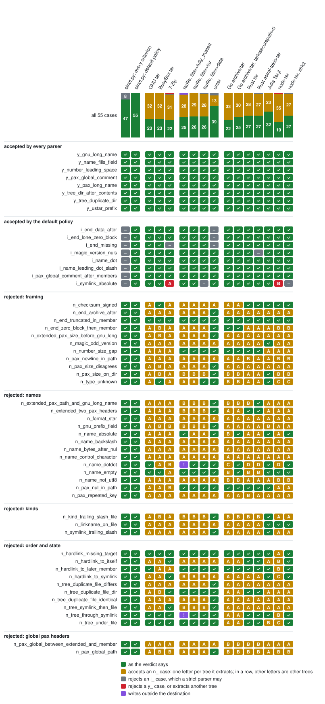

# What implementations make of the corpus

Generated by `corpus/matrix.py` from `matrix.json`: every case of [archives/](archives),
extracted by every implementation, or for libraries without an extractor listed and applied
in order. The two policies of `scanner/strict.py` are from what `tarscan.py` reports.

- ✅ as the verdict says: rejects an `n_` case; extracts the manifest of a `y_` or `i_` case
- ⚠️ accepts an `n_` case. The letter is the tree it extracts: in one row, the same letter is the same tree, and different letters are trees that differ; [MATRIX.md](MATRIX.md#trees) lists them
- ⛔ rejects an `i_` case, which a strict parser may
- ❌ rejects a `y_` case, or extracts another tree than the manifest of a `y_` or `i_` case
- 💥 writes outside the destination

| implementation | version | how |
|---|---|---|
| GNU tar | tar (GNU tar) 1.35 | extracts |
| bsdtar | bsdtar 3.8.5 - libarchive 3.8.5 | extracts |
| live-bootstrap untar | mescc-tools-extra a151c245e512, built with cc | extracts |
| live-bootstrap untar, --non-strict | mescc-tools-extra a151c245e512, built with cc | extracts |
| BusyBox tar | BusyBox v1.37.0 (Ubuntu 1:1.37.0-7ubuntu1) | extracts |
| 7-Zip | 7-Zip 26.00 (x64) | extracts |
| Python tarfile, filter=fully_trusted | CPython 3.14.4 | extracts |
| Python tarfile, filter=tar | CPython 3.14.4 | extracts |
| Python tarfile, filter=data | CPython 3.14.4 | extracts |
| Go archive/tar | archive/tar of go1.26.8 | lists, applied in order |
| Go archive/tar, tarinsecurepath=0 | archive/tar of go1.26.8 | lists, applied in order |
| Rust tar | tar 0.4.46, unpack | extracts |
| Rust astral-tokio-tar | astral-tokio-tar 0.7.0, unpack | extracts |
| Haskell tar | tar 0.7.2.0, extract, of GHC 9.10 | extracts |
| Java Commons Compress | Commons Compress 1.28.0, Expander, on Java 25.0.4.1 | extracts |
| RubyGems | RubyGems 3.6.7 of Ruby 3.3.8, extract_tar_gz | extracts |
| Perl Archive::Tar | Archive::Tar 3.02_001 of Perl v5.40.1 | extracts |
| Julia Tar.jl | Tar 1.10.0 of Julia 1.13.2 | extracts |
| node-tar | tar 7.5.22 | extracts |
| node-tar, strict | tar 7.5.22 | extracts |

| case | strict.py: every criterion | strict.py: default policy | GNU tar | bsdtar | live-bootstrap untar | live-bootstrap untar, --non-strict | BusyBox tar | 7-Zip | Python tarfile, filter=fully_trusted | Python tarfile, filter=tar | Python tarfile, filter=data | Go archive/tar | Go archive/tar, tarinsecurepath=0 | Rust tar | Rust astral-tokio-tar | Haskell tar | Java Commons Compress | RubyGems | Perl Archive::Tar | Julia Tar.jl | node-tar | node-tar, strict |
|---|---|---|---|---|---|---|---|---|---|---|---|---|---|---|---|---|---|---|---|---|---|---|
| **accepted by every parser** | | | | | | | | | | | | | | | | | | | | | | |
| `y_gnu_long_name` | ✅ | ✅ | ✅ | ✅ | ❌ | ❌ | ✅ | ✅ | ✅ | ✅ | ✅ | ✅ | ✅ | ✅ | ✅ | ✅ | ✅ | ❌A | ✅ | ✅ | ✅ | ✅ |
| `y_name_fills_field` | ✅ | ✅ | ✅ | ✅ | ❌A | ❌A | ✅ | ✅ | ✅ | ✅ | ✅ | ✅ | ✅ | ✅ | ✅ | ✅ | ✅ | ✅ | ✅ | ✅ | ✅ | ✅ |
| `y_number_leading_space` | ✅ | ✅ | ✅ | ✅ | ✅ | ✅ | ✅ | ✅ | ✅ | ✅ | ✅ | ✅ | ✅ | ✅ | ✅ | ✅ | ✅ | ✅ | ✅ | ✅ | ✅ | ✅ |
| `y_pax_global_comment` | ✅ | ✅ | ✅ | ✅ | ❌A | ❌A | ✅ | ✅ | ✅ | ✅ | ✅ | ✅ | ✅ | ✅ | ✅ | ✅ | ✅ | ✅ | ✅ | ✅ | ✅ | ✅ |
| `y_pax_long_name` | ✅ | ✅ | ✅ | ✅ | ❌A | ❌A | ✅ | ✅ | ✅ | ✅ | ✅ | ✅ | ✅ | ✅ | ✅ | ✅ | ✅ | ❌B | ❌B | ✅ | ✅ | ✅ |
| `y_tree_dir_after_contents` | ✅ | ✅ | ✅ | ✅ | ✅ | ✅ | ✅ | ✅ | ✅ | ✅ | ✅ | ✅ | ✅ | ✅ | ✅ | ✅ | ✅ | ❌A | ✅ | ✅ | ✅ | ✅ |
| `y_tree_duplicate_dir` | ✅ | ✅ | ✅ | ✅ | ✅ | ✅ | ✅ | ✅ | ✅ | ✅ | ✅ | ✅ | ✅ | ✅ | ✅ | ✅ | ✅ | ❌A | ✅ | ✅ | ✅ | ✅ |
| `y_ustar_prefix` | ✅ | ✅ | ✅ | ✅ | ❌A | ❌A | ✅ | ✅ | ✅ | ✅ | ✅ | ✅ | ✅ | ✅ | ✅ | ✅ | ✅ | ✅ | ✅ | ✅ | ✅ | ✅ |
| **accepted by the default policy** | | | | | | | | | | | | | | | | | | | | | | |
| `i_end_data_after` | ⛔ | ✅ | ✅ | ✅ | ✅ | ✅ | ✅ | ✅ | ✅ | ✅ | ✅ | ✅ | ✅ | ✅ | ✅ | ⛔ | ✅ | ✅ | ✅ | ✅ | ✅ | ✅ |
| `i_end_lone_zero_block` | ⛔ | ✅ | ✅ | ✅ | ✅ | ✅ | ✅ | ✅ | ✅ | ✅ | ✅ | ✅ | ✅ | ✅ | ✅ | ⛔ | ✅ | ✅ | ✅ | ✅ | ✅ | ✅ |
| `i_end_missing` | ⛔ | ✅ | ✅ | ✅ | ✅ | ✅ | ✅ | ⛔ | ✅ | ✅ | ✅ | ✅ | ✅ | ✅ | ✅ | ⛔ | ✅ | ✅ | ✅ | ✅ | ✅ | ✅ |
| `i_magic_version_nuls` | ⛔ | ✅ | ✅ | ✅ | ✅ | ✅ | ✅ | ✅ | ✅ | ✅ | ✅ | ✅ | ✅ | ✅ | ⛔ | ⛔ | ✅ | ✅ | ✅ | ✅ | ✅ | ✅ |
| `i_name_dot` | ⛔ | ✅ | ✅ | ✅ | ✅ | ✅ | ✅ | ✅ | ✅ | ✅ | ✅ | ✅ | ✅ | ✅ | ✅ | ✅ | ✅ | ⛔ | ✅ | ✅ | ✅ | ✅ |
| `i_name_leading_dot_slash` | ⛔ | ✅ | ✅ | ✅ | ✅ | ✅ | ✅ | ✅ | ✅ | ✅ | ✅ | ✅ | ✅ | ✅ | ✅ | ✅ | ✅ | ✅ | ✅ | ✅ | ✅ | ✅ |
| `i_pax_global_comment_after_members` | ⛔ | ✅ | ✅ | ✅ | ❌A | ❌A | ✅ | ✅ | ✅ | ✅ | ✅ | ✅ | ✅ | ✅ | ✅ | ✅ | ✅ | ✅ | ✅ | ✅ | ✅ | ✅ |
| `i_symlink_absolute` | ⛔ | ✅ | ✅ | ✅ | ✅ | ✅ | ✅ | ❌A | ✅ | ✅ | ⛔ | ✅ | ✅ | ✅ | ✅ | ⛔ | ❌B | ⛔ | ⛔ | ✅ | ❌C | ⛔ |
| **rejected: framing** | | | | | | | | | | | | | | | | | | | | | | |
| `n_checksum_signed` | ✅ | ✅ | ⚠️A | ⚠️A | ⚠️A | ⚠️A | ✅ | ⚠️A | ⚠️A | ⚠️A | ⚠️A | ⚠️A | ⚠️A | ✅ | ✅ | ✅ | ⚠️A | ⚠️A | ⚠️A | ✅ | ✅ | ✅ |
| `n_end_archive_after` | ✅ | ✅ | ⚠️A | ⚠️A | ⚠️A | ⚠️A | ⚠️A | ⚠️A | ⚠️A | ⚠️A | ⚠️A | ⚠️A | ⚠️A | ⚠️A | ⚠️A | ✅ | ⚠️A | ⚠️A | ⚠️B | ⚠️A | ⚠️A | ⚠️A |
| `n_end_truncated_in_member` | ✅ | ✅ | ✅ | ✅ | ⚠️A | ⚠️A | ✅ | ✅ | ✅ | ✅ | ✅ | ✅ | ✅ | ✅ | ✅ | ✅ | ✅ | ✅ | ✅ | ✅ | ✅ | ✅ |
| `n_end_zero_block_then_member` | ✅ | ✅ | ⚠️A | ⚠️A | ⚠️A | ⚠️A | ⚠️B | ⚠️A | ⚠️A | ⚠️A | ⚠️A | ✅ | ✅ | ⚠️A | ⚠️A | ✅ | ⚠️A | ⚠️A | ⚠️B | ⚠️A | ⚠️B | ⚠️B |
| `n_extended_pax_size_before_gnu_long` | ✅ | ✅ | ⚠️A | ⚠️A | ✅ | ✅ | ⚠️B | ⚠️A | ⚠️A | ⚠️A | ⚠️A | ⚠️A | ⚠️A | ⚠️A | ⚠️A | ⚠️B | ⚠️A | ⚠️C | ⚠️B | ⚠️A | ⚠️A | ⚠️A |
| `n_magic_odd_version` | ✅ | ✅ | ⚠️A | ⚠️A | ⚠️A | ⚠️A | ⚠️A | ⚠️A | ⚠️A | ⚠️A | ⚠️A | ⚠️A | ⚠️A | ⚠️A | ⚠️A | ✅ | ⚠️A | ⚠️A | ⚠️A | ✅ | ⚠️A | ⚠️A |
| `n_number_size_gap` | ✅ | ✅ | ⚠️A | ✅ | ⚠️A | ⚠️A | ⚠️A | ⚠️A | ✅ | ✅ | ✅ | ✅ | ✅ | ✅ | ✅ | ⚠️A | ✅ | ✅ | ⚠️A | ⚠️A | ⚠️A | ⚠️A |
| `n_pax_newline_in_path` | ✅ | ✅ | ⚠️A | ⚠️A | ⚠️B | ⚠️B | ⚠️A | ⚠️A | ⚠️A | ⚠️A | ⚠️A | ⚠️A | ⚠️A | ⚠️C | ⚠️A | ⚠️A | ⚠️A | ⚠️C | ⚠️C | ⚠️A | ⚠️C | ⚠️C |
| `n_pax_size_disagrees` | ✅ | ✅ | ⚠️A | ⚠️A | ⚠️B | ⚠️B | ⚠️C | ⚠️A | ⚠️A | ⚠️A | ⚠️A | ⚠️A | ⚠️A | ⚠️A | ⚠️A | ⚠️C | ⚠️A | ⚠️C | ⚠️C | ⚠️A | ⚠️A | ⚠️A |
| `n_pax_size_on_dir` | ✅ | ✅ | ⚠️A | ⚠️B | ⚠️C | ⚠️C | ⚠️B | ⚠️A | ⚠️B | ⚠️B | ⚠️B | ⚠️B | ⚠️B | ⚠️A | ⚠️A | ⚠️B | ⚠️A | ⚠️B | ⚠️B | ✅ | ⚠️B | ⚠️B |
| `n_type_unknown` | ✅ | ✅ | ⚠️A | ⚠️A | ⚠️A | ⚠️A | ✅ | ⚠️A | ⚠️A | ⚠️A | ✅ | ⚠️B | ⚠️B | ⚠️A | ⚠️A | ⚠️C | ⚠️A | ⚠️C | ⚠️A | ✅ | ⚠️C | ⚠️C |
| **rejected: names** | | | | | | | | | | | | | | | | | | | | | | |
| `n_extended_pax_path_and_gnu_long_name` | ✅ | ✅ | ⚠️A | ⚠️A | ✅ | ✅ | ⚠️A | ⚠️A | ⚠️B | ⚠️B | ⚠️B | ⚠️B | ⚠️B | ⚠️B | ✅ | ✅ | ⚠️B | ⚠️C | ⚠️C | ⚠️A | ⚠️A | ⚠️A |
| `n_extended_two_pax_headers` | ✅ | ✅ | ⚠️A | ✅ | ⚠️B | ⚠️B | ⚠️A | ⚠️A | ⚠️C | ⚠️C | ⚠️C | ⚠️A | ⚠️A | ✅ | ✅ | ✅ | ⚠️C | ⚠️D | ⚠️D | ⚠️A | ⚠️A | ⚠️A |
| `n_format_star` | ✅ | ✅ | ⚠️A | ⚠️A | ⚠️B | ⚠️B | ⚠️A | ⚠️A | ⚠️A | ⚠️A | ⚠️A | ⚠️A | ⚠️A | ⚠️A | ⚠️A | ⚠️A | ⚠️A | ⚠️A | ✅ | ⚠️A | ⚠️A | ⚠️A |
| `n_gnu_prefix_field` | ✅ | ✅ | ⚠️A | ⚠️A | ⚠️A | ⚠️A | ⚠️B | ⚠️B | ⚠️B | ⚠️B | ⚠️B | ⚠️A | ⚠️A | ⚠️A | ⚠️A | ⚠️B | ⚠️A | ✅ | ⚠️B | ⚠️B | ⚠️A | ⚠️A |
| `n_name_absolute` | ✅ | ✅ | ⚠️A | ⚠️A | ⚠️B | ⚠️B | ⚠️A | ⚠️A | ✅ | ⚠️A | ⚠️A | ⚠️C | ✅ | ⚠️A | ⚠️A | ✅ | ✅ | ✅ | ✅ | ✅ | ⚠️A | ✅ |
| `n_name_backslash` | ✅ | ✅ | ⚠️A | ⚠️A | ⚠️A | ⚠️A | ⚠️A | ⚠️A | ⚠️A | ⚠️A | ⚠️A | ⚠️A | ⚠️A | ⚠️A | ⚠️A | ⚠️A | ⚠️A | ⚠️A | ⚠️A | ⚠️A | ⚠️A | ⚠️A |
| `n_name_bytes_after_nul` | ✅ | ✅ | ⚠️A | ⚠️A | ⚠️A | ⚠️A | ⚠️A | ⚠️A | ⚠️A | ⚠️A | ⚠️A | ⚠️A | ⚠️A | ⚠️A | ⚠️A | ⚠️A | ⚠️A | ✅ | ⚠️A | ⚠️A | ⚠️A | ⚠️A |
| `n_name_control_character` | ✅ | ✅ | ⚠️A | ⚠️A | ⚠️A | ⚠️A | ⚠️A | ⚠️A | ⚠️A | ⚠️A | ⚠️A | ⚠️A | ⚠️A | ⚠️A | ⚠️A | ⚠️A | ⚠️A | ⚠️A | ⚠️A | ⚠️A | ⚠️A | ⚠️A |
| `n_name_dotdot` | ✅ | ✅ | ✅ | ✅ | 💥 | 💥 | ⚠️A | ⚠️B | 💥 | ✅ | ✅ | ⚠️C | ✅ | ⚠️D | ⚠️D | ✅ | ✅ | ✅ | ✅ | ✅ | ⚠️D | ✅ |
| `n_name_empty` | ✅ | ✅ | ✅ | ✅ | ⚠️A | ⚠️A | ✅ | ⚠️B | ✅ | ✅ | ✅ | ⚠️A | ✅ | ⚠️A | ⚠️A | ✅ | ✅ | ✅ | ✅ | ✅ | ✅ | ✅ |
| `n_name_not_utf8` | ✅ | ✅ | ⚠️A | ⚠️A | ⚠️B | ⚠️B | ⚠️A | ⚠️A | ⚠️A | ⚠️A | ⚠️A | ⚠️C | ⚠️C | ⚠️A | ⚠️A | ⚠️A | ⚠️D | ⚠️A | ⚠️A | ⚠️A | ⚠️C | ⚠️C |
| `n_pax_nul_in_path` | ✅ | ✅ | ⚠️A | ⚠️A | ⚠️B | ⚠️B | ⚠️A | ⚠️C | ✅ | ✅ | ✅ | ✅ | ✅ | ✅ | ✅ | ✅ | ✅ | ⚠️C | ⚠️C | ✅ | ⚠️A | ⚠️A |
| `n_pax_repeated_key` | ✅ | ✅ | ⚠️A | ⚠️A | ⚠️B | ⚠️B | ⚠️A | ⚠️A | ⚠️A | ⚠️A | ⚠️A | ⚠️A | ⚠️A | ⚠️C | ⚠️A | ⚠️C | ⚠️A | ⚠️D | ⚠️D | ⚠️A | ⚠️A | ⚠️A |
| **rejected: kinds** | | | | | | | | | | | | | | | | | | | | | | |
| `n_kind_trailing_slash_file` | ✅ | ✅ | ⚠️A | ⚠️A | ⚠️A | ⚠️A | ⚠️B | ⚠️A | ⚠️B | ⚠️B | ⚠️B | ⚠️B | ⚠️B | ⚠️B | ⚠️B | ✅ | ⚠️A | ⚠️B | ⚠️A | ✅ | ⚠️A | ⚠️A |
| `n_linkname_on_file` | ✅ | ✅ | ⚠️A | ⚠️A | ⚠️A | ⚠️A | ⚠️A | ⚠️A | ⚠️A | ⚠️A | ⚠️A | ⚠️A | ⚠️A | ⚠️A | ⚠️A | ⚠️A | ⚠️A | ⚠️A | ⚠️A | ✅ | ✅ | ✅ |
| `n_symlink_trailing_slash` | ✅ | ✅ | ⚠️A | ⚠️A | ✅ | ⚠️B | ⚠️A | ⚠️A | ⚠️A | ⚠️A | ⚠️A | ⚠️A | ⚠️A | ⚠️A | ⚠️A | ✅ | ⚠️C | ⚠️A | ✅ | ✅ | ⚠️A | ⚠️A |
| **rejected: order and state** | | | | | | | | | | | | | | | | | | | | | | |
| `n_hardlink_missing_target` | ✅ | ✅ | ✅ | ✅ | ✅ | ⚠️A | ✅ | ✅ | ✅ | ✅ | ✅ | ✅ | ✅ | ✅ | ✅ | ✅ | ⚠️B | ⚠️A | ✅ | ✅ | ⚠️A | ✅ |
| `n_hardlink_to_itself` | ✅ | ✅ | ⚠️A | ✅ | ✅ | ⚠️A | ⚠️A | ✅ | ⚠️A | ⚠️A | ⚠️A | ⚠️A | ⚠️A | ✅ | ✅ | ⚠️A | ⚠️B | ⚠️C | ✅ | ⚠️A | ⚠️C | ✅ |
| `n_hardlink_to_later_member` | ✅ | ✅ | ✅ | ✅ | ✅ | ⚠️A | ⚠️B | ⚠️B | ✅ | ✅ | ✅ | ✅ | ✅ | ✅ | ✅ | ⚠️B | ⚠️C | ⚠️A | ✅ | ✅ | ⚠️A | ✅ |
| `n_hardlink_to_symlink` | ✅ | ✅ | ⚠️A | ⚠️A | ✅ | ⚠️B | ⚠️A | ✅ | ⚠️C | ⚠️C | ⚠️C | ⚠️A | ⚠️A | ⚠️A | ⚠️A | ✅ | ⚠️D | ⚠️B | ⚠️A | ✅ | ⚠️B | ✅ |
| `n_tree_duplicate_file_differs` | ✅ | ✅ | ⚠️A | ⚠️A | ⚠️A | ⚠️A | ⚠️A | ⚠️A | ⚠️A | ⚠️A | ⚠️A | ⚠️A | ⚠️A | ⚠️A | ⚠️A | ⚠️A | ⚠️A | ⚠️A | ⚠️A | ⚠️A | ⚠️A | ⚠️A |
| `n_tree_duplicate_file_dir` | ✅ | ✅ | ⚠️A | ⚠️A | ⚠️B | ⚠️B | ⚠️B | ✅ | ✅ | ✅ | ✅ | ⚠️A | ⚠️A | ✅ | ✅ | ✅ | ✅ | ⚠️A | ✅ | ⚠️A | ⚠️A | ⚠️A |
| `n_tree_duplicate_file_identical` | ✅ | ✅ | ⚠️A | ⚠️A | ⚠️A | ⚠️A | ⚠️A | ⚠️A | ⚠️A | ⚠️A | ⚠️A | ⚠️A | ⚠️A | ⚠️A | ⚠️A | ⚠️A | ⚠️A | ⚠️A | ⚠️A | ⚠️A | ⚠️A | ⚠️A |
| `n_tree_symlink_then_file` | ✅ | ✅ | ⚠️A | ⚠️A | ⚠️B | ⚠️B | ⚠️A | ✅ | ⚠️B | ⚠️B | ⚠️B | ⚠️A | ⚠️A | ⚠️A | ⚠️A | ✅ | ⚠️A | ⚠️A | ⚠️A | ⚠️A | ⚠️A | ⚠️A |
| `n_tree_through_symlink` | ✅ | ✅ | ✅ | ✅ | 💥 | 💥 | ✅ | ✅ | 💥 | ✅ | ✅ | ⚠️A | ⚠️A | ✅ | ✅ | ✅ | ✅ | ✅ | ✅ | ✅ | ⚠️B | ✅ |
| `n_tree_under_file` | ✅ | ✅ | ✅ | ✅ | ⚠️A | ⚠️A | ✅ | ✅ | ✅ | ✅ | ✅ | ⚠️B | ⚠️B | ✅ | ✅ | ✅ | ✅ | ✅ | ✅ | ⚠️C | ⚠️A | ✅ |
| **rejected: global pax headers** | | | | | | | | | | | | | | | | | | | | | | |
| `n_pax_global_between_extended_and_member` | ✅ | ✅ | ⚠️A | ⚠️A | ⚠️B | ⚠️B | ⚠️A | ⚠️A | ⚠️A | ⚠️A | ⚠️A | ⚠️C | ⚠️C | ⚠️C | ⚠️C | ⚠️C | ⚠️A | ⚠️C | ⚠️C | ⚠️A | ⚠️A | ⚠️A |
| `n_pax_global_path` | ✅ | ✅ | ⚠️A | ⚠️B | ⚠️C | ⚠️C | ⚠️B | ⚠️B | ⚠️A | ⚠️A | ⚠️A | ⚠️B | ⚠️B | ⚠️B | ⚠️B | ⚠️B | ⚠️A | ⚠️B | ⚠️B | ⚠️A | ⚠️B | ⚠️B |
| **total** | ✅47 ⛔8 | ✅55 | ✅23 ⚠️32 | ✅26 ⚠️29 | ✅17 ⚠️30 ❌6 💥2 | ✅12 ⚠️35 ❌6 💥2 | ✅23 ⚠️32 | ✅22 ⚠️31 ⛔1 ❌1 | ✅25 ⚠️28 💥2 | ✅26 ⚠️29 | ✅26 ⚠️28 ⛔1 | ✅22 ⚠️33 | ✅25 ⚠️30 | ✅27 ⚠️28 | ✅27 ⚠️27 ⛔1 | ✅30 ⚠️20 ⛔5 | ✅24 ⚠️30 ❌1 | ✅19 ⚠️30 ⛔2 ❌4 | ✅26 ⚠️27 ⛔1 ❌1 | ✅32 ⚠️23 | ✅19 ⚠️35 ❌1 | ✅27 ⚠️27 ⛔1 |

## Trees

What the implementations that accept a case extract, where it is not its manifest: files by their size and the start of their sha256.

- `y_gnu_long_name`: A: `dddddddddddddddddddddddddddddddddddddddddddddddddddddddddddd/`, `dddddddddddddddddddddddddddddddddddddddddddddddddddddddddddd/fffffffffffffffffffffffffffffffffffffff` (5 B, bbdbb75b)
- `y_name_fills_field`: A: `nnnnnnnnnnnnnnnnnnnnnnnnnnnnnnnnnnnnnnnnnnnnnnnnnnnnnnnnnnnnnnnnnnnnnnnnnnnnnnnnnnnnnnnnnnnnnnnnnnnn0000644` (5 B, 0e716a5f)
- `y_pax_global_comment`: A: `pax_global_header` (52 B, e00a4a95), `project/`, `project/README` (6 B, 5891b5b5)
- `y_pax_long_name`: A: `PaxHeader` (131 B, 8cc43c67), `dddddddddddddddddddddddddddddddddddddddddddddddddddddddddddd/`, `dddddddddddddddddddddddddddddddddddddddddddddddddddddddddddd/fffffffffffffffffffffffffffffffffffffff0000644` (5 B, bbdbb75b); B: `dddddddddddddddddddddddddddddddddddddddddddddddddddddddddddd/`, `dddddddddddddddddddddddddddddddddddddddddddddddddddddddddddd/fffffffffffffffffffffffffffffffffffffff` (5 B, bbdbb75b)
- `y_tree_dir_after_contents`: A: nothing
- `y_tree_duplicate_dir`: A: `d/`
- `y_ustar_prefix`: A: `file` (9 B, 7dd9c6f9)
- `i_pax_global_comment_after_members`: A: `a` (2 B, 87428fc5), `b` (2 B, 02638299), `pax_global_header` (19 B, 89c2f7ac)
- `i_symlink_absolute`: A: `link` → `DEST/tar-minefield-nonexistent`; B: `link` (0 B, e3b0c442); C: `link` → `tar-minefield-nonexistent`
- `n_checksum_signed`: A: `a` (2 B, 87428fc5)
- `n_end_archive_after`: A: `a` (2 B, 87428fc5); B: `a` (2 B, 87428fc5), `hidden` (57 B, 150e5c88)
- `n_end_truncated_in_member`: A: `a` (512 B, 64164443)
- `n_end_zero_block_then_member`: A: `a` (2 B, 87428fc5); B: `a` (2 B, 87428fc5), `hidden` (44 B, d688c765)
- `n_extended_pax_size_before_gnu_long`: A: `long-name` (512 B, 917dba8e); B: `long-name` (0 B, e3b0c442), `smuggled` (0 B, e3b0c442); C: `short-name` (0 B, e3b0c442), `smuggled` (0 B, e3b0c442)
- `n_magic_odd_version`: A: `a` (2 B, 87428fc5)
- `n_number_size_gap`: A: `a` (0 B, e3b0c442), `smuggled` (0 B, e3b0c442)
- `n_pax_newline_in_path`: A: `good\x0a1 path=evil` (12 B, a578eb49); B: `PaxHeader` (25 B, 19000a4f), `plain` (12 B, a578eb49); C: `plain` (12 B, a578eb49)
- `n_pax_size_disagrees`: A: `a` (0 B, e3b0c442), `smuggled` (0 B, e3b0c442); B: `PaxHeader` (9 B, 33638443), `a` (512 B, 917dba8e); C: `a` (512 B, 917dba8e)
- `n_pax_size_on_dir`: A: `dir/`; B: `dir/`, `dir/smuggled` (0 B, e3b0c442); C: `PaxHeader` (12 B, 609af461), `dir/`, `dir/smuggled` (0 B, e3b0c442)
- `n_type_unknown`: A: `unknown` (512 B, 917dba8e); B: `unknown` (other); C: nothing
- `n_extended_pax_path_and_gnu_long_name`: A: `from-pax` (12 B, a578eb49); B: `from-gnu` (12 B, a578eb49); C: `from-header` (12 B, a578eb49)
- `n_extended_two_pax_headers`: A: `second` (12 B, a578eb49); B: `PaxHeader` (15 B, 7c8761f1), `header-name` (12 B, a578eb49); C: `first` (12 B, a578eb49); D: `header-name` (12 B, a578eb49)
- `n_format_star`: A: `dir/`, `dir/a` (2 B, 87428fc5); B: `a` (2 B, 87428fc5)
- `n_gnu_prefix_field`: A: `a` (2 B, 87428fc5); B: `15000000000/`, `15000000000/a` (2 B, 87428fc5)
- `n_name_absolute`: A: `tar-minefield-absolute` (89 B, 3b7f22a5); B: nothing; C: `/tar-minefield-absolute` (89 B, 3b7f22a5)
- `n_name_backslash`: A: `a\b` (21 B, 15acfc39)
- `n_name_bytes_after_nul`: A: `a` (10 B, ef476e8d)
- `n_name_control_character`: A: `a\x0ab` (21 B, 93d2f841)
- `n_name_dotdot`: A: `tar-minefield-escaped` (85 B, fc503701); B: `tar-minefield/`, `tar-minefield/tar-minefield-escaped` (85 B, fc503701); C: `tar-minefield/`, `tar-minefield/../`, `tar-minefield/../../`, `tar-minefield/../../tar-minefield-escaped` (85 B, fc503701); D: nothing
- `n_name_empty`: A: nothing; B: `n_name_empty` (8 B, aee7b480)
- `n_name_not_utf8`: A: `caf\xe9` (8 B, ff3f1fa3); B: nothing; C: `caf�` (8 B, ff3f1fa3); D: `caf?` (8 B, ff3f1fa3)
- `n_pax_nul_in_path`: A: `a` (12 B, 627be4bf); B: `PaxHeader` (12 B, 6f855603), `header-name` (12 B, 627be4bf); C: `header-name` (12 B, 627be4bf)
- `n_pax_repeated_key`: A: `second` (12 B, a578eb49); B: `PaxHeader` (29 B, 14422e4d), `header-name` (12 B, a578eb49); C: `first` (12 B, a578eb49); D: `header-name` (12 B, a578eb49)
- `n_kind_trailing_slash_file`: A: `a/`; B: `a` (0 B, e3b0c442)
- `n_linkname_on_file`: A: `a` (19 B, bc345849)
- `n_symlink_trailing_slash`: A: `link` → `target`, `target/`; B: `target/`; C: `link/`, `target/`
- `n_hardlink_missing_target`: A: nothing; B: `h` (0 B, e3b0c442)
- `n_hardlink_to_itself`: A: `a` (2 B, 87428fc5); B: `a` (0 B, e3b0c442); C: nothing
- `n_hardlink_to_later_member`: A: `f` (2 B, 092fcfbb); B: `f` (2 B, 092fcfbb), `h` (2 B, 092fcfbb); C: `f` (2 B, 092fcfbb), `h` (0 B, e3b0c442)
- `n_hardlink_to_symlink`: A: `f` (2 B, 092fcfbb), `h` → `f`, `s` → `f`; B: `f` (2 B, 092fcfbb), `s` → `f`; C: `f` (2 B, 092fcfbb), `h` (2 B, 092fcfbb), `s` → `f`; D: `f` (2 B, 092fcfbb), `h` (0 B, e3b0c442), `s` (0 B, e3b0c442)
- `n_tree_duplicate_file_differs`: A: `a` (5 B, 761d1fb1)
- `n_tree_duplicate_file_dir`: A: `a/`; B: `a` (13 B, 294e546a)
- `n_tree_duplicate_file_identical`: A: `a` (5 B, a6328afc)
- `n_tree_symlink_then_file`: A: `a` (28 B, d5a04bbb); B: `a` → `target`, `target` (28 B, d5a04bbb)
- `n_tree_through_symlink`: A: `d` → `..`, `d/tar-minefield-through-symlink` (89 B, 3b7f22a5); B: `d/`, `d/tar-minefield-through-symlink` (89 B, 3b7f22a5)
- `n_tree_under_file`: A: `a` (7 B, da69f286); B: `a` (7 B, da69f286), `a/b` (13 B, 8e53e378); C: `a/`, `a/b` (13 B, 8e53e378)
- `n_pax_global_between_extended_and_member`: A: `from-pax` (12 B, a578eb49); B: `PaxHeader` (17 B, 45b5e3aa), `header-name` (12 B, a578eb49), `pax_global_header` (19 B, d0b8d0ef); C: `header-name` (12 B, a578eb49)
- `n_pax_global_path`: A: `global-name` (2 B, 02638299); B: `a` (2 B, 87428fc5), `b` (2 B, 02638299); C: `a` (2 B, 87428fc5), `b` (2 B, 02638299), `pax_global_header` (20 B, d5acb589)
